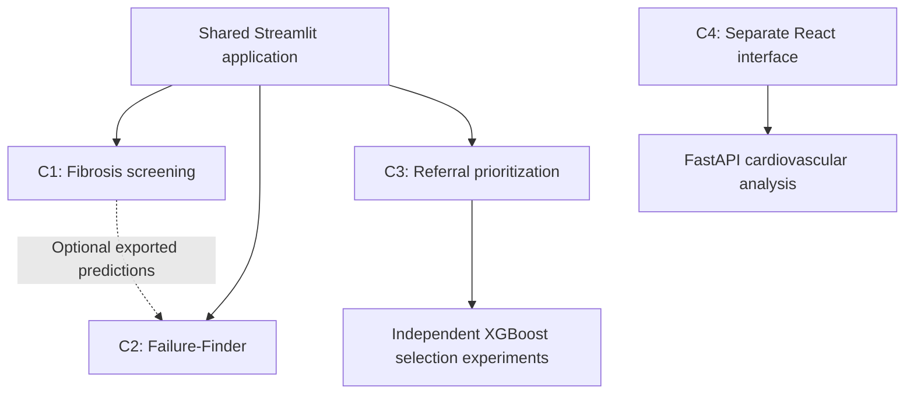

# Machine-Learning Investigation of Non-Invasive Significant Liver Fibrosis Screening in MASLD

- **Project:** J26-IT-414
- **Institution:** Sri Lanka Institute of Information Technology (SLIIT), Faculty of Computing
- **Supervisor:** Dr. Prasanna Sumathipala
- **Stage:** Progress Presentation 1 (PP1), October 2026

A four-member final-year research project exploring fibrosis screening, screening failures, limited scan allocation and cardiovascular risk analysis. MASLD means **Metabolic Dysfunction-Associated Steatotic Liver Disease**.

The shared Streamlit application currently contains **Components 1, 2 and 3**. **Component 4 runs separately** through FastAPI and React/Vite. These are research prototypes, and the current results do not establish clinical performance in Sri Lankan clinics.

## Research problem and objective

When scan capacity is limited, a screening workflow must consider more than prediction accuracy. It must examine which patients a screening rule misses, which patients to select within an available scan budget, how uncertainty affects decisions, and whether liver-related information adds value to cardiovascular risk prediction.

The project develops and evaluates four complementary components using routine patient information and recorded outcomes. The intended setting is resource-constrained care in Sri Lanka. Current development uses public or component-specific demonstration data, while the Kelaniya dataset required for local evaluation remains pending.

## Team and components

| Component | Member | Student ID | Current implementation |
| --- | --- | --- | --- |
| **C1: Fibrosis screening and FibroScan referral** | Sharuka G | IT23229884 | Calibrated screening model, conformal three-zone decisions, SHAP explanations and FIB-4 comparisons |
| **C2: Failure-Finder** | Abdul Rahman N. | IT23365896 | Audits screening decisions, identifies candidate groups with missed positive outcomes, and checks individual patients against red-flag groups |
| **C3: Scarce Resource Referral Prioritization** | Aaqib A.R | IT23228276 | Compares five patient-selection policies under equal scan budgets, independently retrains XGBoost and verifies saved outputs |
| **C4: Cardiovascular risk prediction and explainability** | Fernando P.H.N | IT23285774 | Separate cardiovascular modelling application comparing baseline and fibrosis-enhanced models, with SHAP and model-comparison views |

### Current architecture



C3 currently trains its own prediction model and does not depend on C1 predictions. C2 can audit FIB-4 or optionally consume C1 prediction exports. The components have different cohort definitions and data requirements, so they should not be treated as a single validated end-to-end clinical pathway.

## Quick start: shared application

Use **Python 3.12 or later** for the current dependency set. Run commands from the repository root unless a section says otherwise.

```bash
git clone https://github.com/NaushadAbdulRahman/J26-IT-414-Research-Project-.git
cd J26-IT-414-Research-Project-
python -m venv .venv
```

Activate the environment on macOS/Linux:

```bash
source .venv/bin/activate
```

Or on Windows PowerShell:

```powershell
.venv\Scripts\Activate.ps1
```

Install the shared dependencies and launch:

```bash
python -m pip install -r requirements.txt
python -m streamlit run app/Home.py
```

Open the local URL printed in the terminal and choose a component from the sidebar. **A fresh clone does not contain the locally prepared datasets and generated training outputs.** Prepare the component you want to demonstrate using the instructions below.

The home page still lists C4 as a placeholder. Its current working interface is the separate application described under Component 4.

## Component 1: fibrosis screening and referral

C1 uses routine clinical features to produce **SCAN / NO SCAN / UNSURE**, an estimated risk and SHAP explanations. The pipeline compares candidate classifiers, chooses calibration on training data and applies a class-conditional conformal decision layer. It benchmarks the resulting decisions against FIB-4.

The default NHANES cohort approximates MASLD using scan quality, CAP and metabolic-factor criteria. Its reported sample contains 2,984 adults. The implementation also supports an all-adult sensitivity analysis, synthetic practice data and a local-data adapter. See the component documentation for cohort rules, assumptions and reported results.

**Prepare data:** place `P_DEMO.xpt`, `P_BMX.xpt`, `P_BIOPRO.xpt`, `P_CBC.xpt`, `P_GHB.xpt`, `P_DIQ.xpt` and `P_LUX.xpt` in `component-1-fibrosis-screening/data/nhanes/`.

```bash
cd component-1-fibrosis-screening
python -m pip install -r requirements.txt
python src/run_all.py
python -m pytest -q
python -m streamlit run src/app.py
```

For the shared application, return to the repository root and launch `app/Home.py` instead of the standalone page. Optional C1 predictions for C2 can be exported from the C1 directory with `python src/export_predictions.py all`.

**Remaining evaluation:** local-cohort validation and external NHANES evaluation when the required files are available. A conformal guarantee depends on its statistical assumptions and is not a guarantee for every individual patient.

Details: [Component 1 README](component-1-fibrosis-screening/README.md)

## Component 2: Failure-Finder

C2 asks which groups a screening tool clears despite recorded positive scan outcomes. It audits FIB-4 rules or optional C1 predictions, tests candidate groups against the referral bar using an exact binomial test, adjusts for multiple testing with Benjamini-Hochberg, and provides a red-flag check for individual patients. Its present NHANES cohort focuses on adults with diabetes.

**Prepare data:** place the seven NHANES files listed for C1 in the repository's `data/raw/` directory. C2's build script uses this location, rather than C1's component-local data directory.

From the repository root:

```bash
python src/build_cohort.py
python component-2-failure-finder/src/build_table.py
python component-2-failure-finder/src/find_groups.py flat
python component-2-failure-finder/src/test_groups.py flat
python component-2-failure-finder/src/find_groups.py age_adjusted
python component-2-failure-finder/src/test_groups.py age_adjusted
python component-2-failure-finder/src/run_audit.py flat
python -m pytest component-2-failure-finder/tests -q
python -m streamlit run app/Home.py
```

The two rule-specific group exports support the individual patient checker. The audit interface can recompute group evidence for the selected screening tool. Candidate subgroup findings require further evaluation; the component README describes split-half retesting and remaining experiments.

Details: [Component 2 README](component-2-failure-finder/README.md), [requirements](component-2-failure-finder/docs/REQUIREMENTS.md), [risk register](component-2-failure-finder/docs/RISK_REGISTER.md)

## Component 3: Scarce Resource Referral Prioritization

C3 compares how to allocate limited scan slots for **immediate case detection** and **future model improvement**. Its current cohort includes **all eligible adults aged 18+**, including people without diabetes.

XGBoost takes age, sex, BMI, AST, ALT, platelet count and diabetes indicators as pre-scan inputs. It outputs a score for the provisional target **observed liver stiffness ≥8 kPa**. Scan stiffness and other scan-derived measurements are excluded from predictors. This target does not establish a confirmed fibrosis diagnosis or clinical urgency, and the scores have not been calibrated.

### Selection policies

| Strategy | Patient-selection rule |
| --- | --- |
| Random | Seeded random selection as a reference |
| Risk-first | Highest predicted elevated-stiffness scores |
| Uncertainty | Scores closest to 0.5, where the model is least decisive |
| Diversity | Profiles farthest from the nearest labelled or already selected patient, with distance preprocessing fitted on the initial labelled group |
| Hybrid | Equal weighting of uncertainty and normalized diversity, updating diversity as patients are selected |

### Prepare and run

From the repository root:

```bash
python -m pip install -r requirements-c3.txt
python scripts/download_nhanes.py
python scripts/prepare_nhanes.py
python scripts/train_c3_baseline.py --threshold-kpa 8
python scripts/compare_c3_strategies.py --budget 20
python -m unittest discover -s tests -p test_c3_verification.py -v
python -m streamlit run app/Home.py
```

`requirements-c3.txt` records additional version pins for reproducing the C3 environment. Use a separate virtual environment if another component requires different versions.

The C3 downloader fetches six files into `data/raw/nhanes_2017_2020/`. It does not fetch `P_GHB.xpt`, which C1 and C2 require. Prepared C3 data and experiment outputs go under `data/interim/nhanes_2017_2020/`.

### Retrospective experiment

The current seed-42 cohort contains 7,768 eligible adults:

| Data group | Patients | Purpose |
| --- | ---: | --- |
| Initial labelled training | 400 | Train the starting XGBoost model |
| Simulated waiting pool | 4,260 | Candidates whose outcomes are hidden from the selection strategies |
| Validation | 1,554 | Evaluate models after retraining |
| Reserved final test | 1,554 | Excluded from the current comparison |

Each strategy starts from the same model and waiting pool, independently selects **10, 20 or 50** patients, then receives only its selected patients' recorded outcomes. A fresh XGBoost model is fitted on the initial group plus that strategy's selected batch and evaluated on the same validation group.

The current prototype runs **one batch per strategy**. Repeating a configuration reproduces the same experiment; it does not advance to a new round. The interface's **Show recorded outcomes** checkbox displays outcomes from the completed simulation and does not trigger retraining.

### Current 20-scan demonstration results

Starting validation AUROC: **0.7337**.

| Strategy | Positive scans / 20 | Precision at 20 | Validation AUROC after retraining |
| --- | ---: | ---: | ---: |
| Random | 1 / 20 | 5% | 0.7294 |
| Risk-first | 12 / 20 | 60% | 0.7286 |
| Uncertainty | 6 / 20 | 30% | 0.7232 |
| Diversity | 8 / 20 | 40% | 0.7529 |
| Hybrid | 6 / 20 | 30% | 0.7290 |

Risk-first finds the most positives in this run. Diversity produces the highest validation AUROC, improving it by **0.0192**. These are different objectives, and one split and batch do not establish a universally best strategy. Metrics are unweighted demonstration results, rather than population estimates.

### Verification and code organization

The four dashboard tabs cover the overview, selection demo, result explanations and verification. Explanations remain visible and information sections start expanded.

| File | Responsibility |
| --- | --- |
| `app/pages/3_Component_3_Referral_Prioritization.py` | Streamlit controls and displayed results |
| `app/c3_verification.py` | Strategy descriptions and reusable output-verification functions |
| `scripts/train_c3_baseline.py` | Splits, initial training and baseline report |
| `scripts/compare_c3_strategies.py` | Five independent selection/retraining experiments and output exports |
| `tests/test_c3_verification.py` | 13 focused verification tests using synthetic fixtures |

The verification button checks partition IDs, scan budgets, unique selected patients, recorded outcomes, positive counts, precision and input-file SHA-256 fingerprints. It also recomputes AUROC, average precision and Brier score from `validation_predictions.csv`. Missing evidence is reported as unavailable, rather than counted as a pass. Rerun older comparison folders once to create this prediction export.

These checks establish numerical and file consistency. Statistical reliability still requires repeated experiments, and clinical transfer requires local evaluation.

**Planned research:** sequential acquisition rounds, repeated trials and learning curves, an XGBoost-informed acquisition extension, explicit equity constraints, budget sensitivity analysis and a statistical plateau rule. Their novelty and benefit still need literature support and experimental evaluation. A learning plateau concerns model improvement from additional labels, rather than when clinical scans should stop.

Details: [C3 demonstration and evidence guide](docs/c3-demo-guide.md)

## Component 4: cardiovascular risk prediction and explainability

C4 investigates the additional predictive value of fibrosis-related information for cardiovascular outcomes. Its backend compares baseline and enhanced feature sets across logistic regression, random forest and XGBoost, and supplies model metrics, SHAP explanations and decision-support views to a separate React interface.

**Prerequisites:** Python dependencies below, npm and Node.js **22.12+** (compatible with the committed Vite lockfile).

**Data requirement:** supply the component-specific cohort at `component-4-cardiovascular-prediction/data/masld_patient_cohort.csv`, following the component's schema, including the `cvd_event` target. Its current backend trains at startup and raises an error if this dataset is missing or incomplete. The committed model artifacts do not make this dataset requirement optional. Dataset provenance and local clinical validation must be established before presenting clinical performance claims.

```bash
cd component-4-cardiovascular-prediction
python -m pip install -r requirements.txt
cd frontend
npm ci --legacy-peer-deps
cd ..
python run_app.py
```

The launcher starts the frontend at [http://127.0.0.1:5173](http://127.0.0.1:5173) and the API at [http://127.0.0.1:8000/docs](http://127.0.0.1:8000/docs). C4 is not currently a page in the shared Streamlit sidebar.

Details: [Component 4 README](component-4-cardiovascular-prediction/README.md)

## Repository organization

| Location | Purpose |
| --- | --- |
| `app/Home.py` | Shared Streamlit entry point |
| `app/pages/` | C1, C2 and C3 pages |
| `component-1-fibrosis-screening/` | C1 pipeline, standalone app and tests |
| `component-2-failure-finder/` | C2 audits, patient checks, documentation and tests |
| `component-4-cardiovascular-prediction/` | C4 backend, frontend, notebook and model artifacts |
| `scripts/` | C3 data preparation, training and comparison scripts |
| `shared/fib4.py` | Reusable FIB-4 calculation and rule definitions |
| `src/` | Earlier cohort preparation and supporting research scripts, including C2 cohort preparation |
| `tests/` | Root-level C3 verification tests |
| `docs/` | Component plans, diagrams and demonstration instructions |
| `data/` and component-specific data folders | Local datasets and generated records, excluded by Git rules |

## Current limitations and next evaluation

- Component cohorts and labels differ. Agree on the local dataset schema and integration boundaries before combining outputs.
- Public US NHANES results do not establish performance in Sri Lankan clinics. Local evaluation remains pending for the relevant components.
- Scan stiffness is a measurement used to define research endpoints. It should not be described as a biopsy-confirmed fibrosis stage.
- C3's current results come from a single split and acquisition batch. Equity constraints and the proposed custom selection extension are not yet implemented.
- C4 requires its own outcome-bearing dataset and separate application setup. It is not yet integrated into the shared interface.

## Data handling and collaboration

Do not commit patient-level records, credentials, local environment files or generated data exports. The repository's `.gitignore` excludes CSV/XPT data, local data folders, virtual environments and most generated output folders. Review staged files before committing, including notebooks and archives that can contain embedded data.

Use feature branches and pull requests into `main`, with focused commits for each change. Each member maintains the detailed documentation for their component. The root README describes the current group-level setup and implementation boundaries.

**Research use only. The software supports research demonstrations and is not intended for clinical decision-making.**
